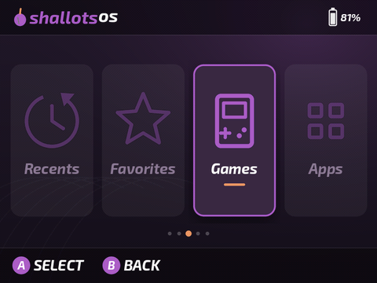

# TreeFrogUI - Retro Emulation Frontend

🌐 **[TreeFrogUI website](https://tzubertowski.github.io/TreeFrogUI/)** - releases, news, and notes

A free, custom game-menu (frontend) for a range of MIPS-based Hichip handhelds - R36SX, SF3000, SF3500, GB350 and more (full list below). It replaces the stock menu and runs hundreds of retro systems.

**Supported devices:** R36SX (v2.6 & v2.7), **R36 HD** (and R36SX clones - see [install guide](install.md#r36sx-clones-r36hd-etc)), SF3000, SF3000 HD, SF3100, SF3500, and GB350.


> ### 🧅 ShallotsOS
> ShallotsOS is a TreeFrogUI fork that looks and feels like
> [OnionOS](https://github.com/OnionUI/Onion): an OnionOS-style home screen,
> console grid, lists and GameSwitcher, and support for **OnionOS themes**. Copy
> any OnionOS theme folder or `.zip` into `Themes/` on the SD card and pick it in
> Settings → Appearance → **OnionOS Theme**. See
> [OnionOS themes](theme.md#onionos-themes).
>
> 

> # ☕ Consider donating to extend device support: [ko-fi.com/proszty](https://ko-fi.com/proszty)
> 💬 Join the [TreeFrogUI community server](https://discord.gg/JYFsmBYFBd) on Discord.
> TreeFrogUI is free and made by one person. Every device I support, I bought with my own money. Donations are what let me buy the next handheld and add support for it (R36SX v2.7, SF3000 V3, SF3500, SF3100, GB350, HDMI clones, and more).
>
> If TreeFrogUI gave you some fun, please consider chipping in. It genuinely decides whether the next port happens.
>
> ### 👉 [**Donate here: ko-fi.com/proszty**](https://ko-fi.com/proszty) 🙏
> ### 💬 [**TreeFrogUI community server**](https://discord.gg/JYFsmBYFBd)

### New here? Start with these
- 🧰 **How to install it** - use our [TreeFrogUI Installer](https://github.com/tzubertowski/TreeFrogUI-installer/releases), or [follow the manual installation steps](install.md)
- 🕹️ **[How to add games + which folder](#rom-folder-setup)** - where to put your ROMs
- 🔌 **[Use a USB/OTG drive as a game library](docs/otg-storage.md)** - play ROMs directly from external storage
- 🎨 **[How to customise it](theme.md)** - themes, fonts, game art / box art / thumbnails, backgrounds
- 🖼️ **[Get box art in three clicks](https://github.com/tzubertowski/mini-scraper-cfw/releases)** - download Mini Scraper, choose your SD card, then press **Add artwork**
- ⬇️ **[Download the latest version](https://github.com/tzubertowski/treefrog-ui/releases)**
- 💬 **[Report a bug / give feedback](https://docs.google.com/forms/d/e/1FAIpQLSfM-y2_UnERrjScqkSfkRSEfBPJ79rDwDo3GwuYWXxpkFTp4Q/viewform?usp=header)**

---

## What's included

| Component | What it does |
|-----------|-------------|
| **TreeFrogUI** (`frogui_libretro.so`) | ROM browser and launcher, runs inside picoarch |
| **58 emulator cores** | NES, SNES, GBA, Mega Drive, PC Engine, Amiga, Atari ST, J2ME, and more |
| **build system** | Cross-compile everything from source using the SF3000 toolchain |

See [cores.md](cores.md) for the full folder→core mapping table.

---

## Why TreeFrogUI?

- **Minimalistic but powerful UI** - Clean, fast game selection screen with quick navigation.
- **58 emulator cores** - Now supports 58 emulator cores compared to only 14 in the stock OS. This includes **Java Games** (J2ME / MIDP 2.0), **PICO-8** (via Fake08/Retro8), **Quake** (via Tyrquake), **Cave Story** (via NXEngine), **Doom** (via PrBoom), **PlayStation 1** (via PCSX ReArmed), plus classic computer systems like Commodore Amiga and Atari ST.
- **Highly configurable cores** - Configurable settings for all cores, allowing for retro features like console palette swaps, LCD ghosting emulation, and more.
- **In-game saves** - Fully supported across all compatible cores for seamless session saving and loading.
- **Quick Resume** - Automatically boots back into the last played game upon device boot, skipping the frontend.
- **Auto-Save/Auto-Load** - Auto-saves state on pause/quit and auto-loads it on any game launch (Quick Resume boot or a manual pick from the frontend). Independent of Quick Resume - turn it on to always pick up mid-game, however you launch.
- **Clean, configurable menu** - Smooth background crossfades, an optional horizontal system carousel, an optional **Hide Empty Folders** setting, and right-stick drift filtering so accidental touches don't trigger phantom presses while navigating.
- **Rich theming options** - Custom background images, fonts, and 30 built-in themes.
- **Game switcher** - Optional OnionOS-style recents carousel: big box art, or a screenshot of where you left off (every game is auto-screenshotted on exit), resumes the game. Turn it on in Settings (Game Switcher), it replaces the recents list.
- **Start in Recents** - Optional: boot straight into your recents (list or switcher) every time, in Settings.
- **Play-time stats** - Tracks how long you play each game, shown in the browser.
- **Ebook reader** - Read **EPUB / MOBI / PDF / CBZ / FB2** on the go (MuPDF-powered): put files in `Books/` at the card root (or `roms/Ebook/`), adjustable text size + font (custom TTFs supported), progress saved per book. See the [ebook guide](docs/cores/ebook.md).
- **Video player** - Drop ordinary **MP4 / MKV / AVI / MOV / WMV** files into `Videos/` at the card root (or `roms/videos/`). Playback uses the firmware hardware decoder; its MinUI-style controls inherit your active theme colors and follow each device's native panel orientation. No conversion required.
- **Simple music player** - Put **MP3 / M4A / AAC / WAV / FLAC / OGG / Opus** files in a folder under `Music/` at the card root (or `roms/music/`). If both have files, `roms/music` shows up as a folder inside the Music app (the same goes for Videos, Books and Images). Each folder acts as a playlist with alphabetical auto-advance, X/Y previous/next, sequential/loop/random modes, embedded ID3v1/ID3v2 metadata and album covers, and a themed interface. Rockbox remains available for advanced library features.
- **Image viewer** - Browse **JPG / PNG / BMP / GIF / WebP / TIFF** files from `Images/` at the card root (or `roms/images/`), with Fit/Fill, reliable 1x–4x JPEG/PNG zoom, D-pad panning, and the same themed controls as the music and video players.
- **Offline updates** - Copy the official `update.zip` directly to the SD-card root and reboot. It is checksum-verified, applied for the correct device, and deleted only after success. See the [installation guide](install.md#offline-updates).
- **OTG game library** - Plug in a FAT32 USB drive with a `roms/` folder and choose it as a separate SD/OTG game source in Settings. See the [OTG storage guide](docs/otg-storage.md).
- **Proper PCSX4ALL support** - Configurable PlayStation 1 emulator core with native support for `.iso`, `.bin`/`.cue`, and other disc formats.
- **Flexible display scaling** - Easily adjust display scaling modes (Zoom, Aspect Ratio, and Integer Scaling) to suit your preference.

### Display scaling by device

R36SX supports the complete hardware aspect-ratio menu. SF3000/SF3500 expose
Integer, Native, and Fill only because their rotated stock display drivers do
not provide an arbitrary HCGE viewport/crop control; see
[the display-scaling guide](docs/display-scaling.md).

---
## ROM folder setup

ShallotsOS uses **Recalbox's folder names**: one folder per system inside
`roms`, such as `roms/nes`, `roms/gbc`, `roms/megadrive` or `roms/psx`
([Recalbox systems list](https://wiki.recalbox.com/en/tutorials/themes/tree/systems-list)).
They are created on first boot, and empty ones are hidden from the Games list.

**How to add games:** copy the game files into the system's folder, then put
the card back in. New games are found on their own.

**Picking an emulator:** the folder no longer decides the emulator. Each
system starts on its default (first in the table). Press **Y** on a game for
its menu: **Emulator** (Left/Right), **Apply to** *This game* or *Whole
system*, then A. Y on a system in the Games list sets the emulator for the
whole system. The same menu has **Search** and **Add to / Remove from
Favourites**.

**Coming from TreeFrogUI:** on the first boot, ShallotsOS offers to move your
games out of TreeFrogUI's folders (`nesq`, `gbav`, `sega`, `a26`, `ps1`...)
into these. Games, saves, save states, artwork and gamelists are moved, never
deleted; Recents, Favourites, play time and per-game emulator choices follow
them, and games from an emulator folder (`nesq` = QuickNES) keep that
emulator. A mixed folder is split by file type (`.gbc` files in `gb` go to
`gbc`, `.sms` / `.gg` in `sega` go to `mastersystem` / `gamegear`). A file
whose name is taken in the new folder stays where it was. Choosing Cancel
powers the console off and asks again next time.

| Folder | System | Emulators (default first; Y on a game to change) | Old TreeFrogUI folders |
|---|---|---|---|
| **nes** | Nintendo Entertainment System | `fceumm`, `quicknes`, `nestopia` | `FC`, `nesq`, `nest` |
| **fds** | Family Computer Disk System | `fceumm` |  |
| **snes** | Super Nintendo Entertainment System | `snes9x2005_plus`, `snes9x2002`, `snes9x2005`, `snes9x2010`, `hcsnes_fast`, `hcsnes_plus` | `SFC`, `snes02` |
| **gb** | Game Boy | `gambatte`, `gearboy`, `tgbdual` | `gbgb`, `gbb`, `dblcherrygb` |
| **gbc** | Game Boy Color | `gambatte`, `gearboy`, `tgbdual` |  |
| **gba** | Game Boy Advance | `gpsp`, `gpsp_multicore`, `vba_next`, `mgba` | `gbac`, `gbav`, `mgba`, `gbaf` |
| **nds** | Nintendo DS | DSperate (standalone) |  |
| **virtualboy** | Virtual Boy | `mednafen_vb` | `vb` |
| **pokemini** | Pokémon Mini | `pokemini` | `pokem` |
| **gw** | Game and Watch | `gw` |  |
| **megadrive** | Sega Megadrive | `picodrive`, `genesis_plus_gx` | `sega`, `MD`, `gpgx` |
| **mastersystem** | Sega Master System / Mark III | `picodrive`, `genesis_plus_gx`, `gearsystem` | `SMS` |
| **gamegear** | Sega Game Gear | `gearsystem`, `genesis_plus_gx`, `picodrive` | `gg`, `GG` |
| **sg1000** | Sega SG1000 | `genesis_plus_gx`, `gearsystem` |  |
| **segacd** | Sega CD | `genesis_plus_gx`, `picodrive` |  |
| **sega32x** | Sega 32X | `picodrive` | `32x` |
| **psx** | Sony Playstation 1 | `pcsx4all` (standalone), `pcsx_rearmed`, `qpsx` | `ps1`, `PS`, `ps1r`, `qpsx` |
| **psp** | Sony Playstation Portable | `ppsspp` (standalone), `ppsspp` |  |
| **pcengine** | PC Engine | `mednafen_pce_fast`, `mednafen_supergrafx` | `pce` |
| **supergrafx** | Supergrafx | `mednafen_supergrafx` | `pcesgx` |
| **pcfx** | NEC PC-FX | `mednafen_pcfx` |  |
| **pc88** | NEC PC-88 | `quasi88` | `pc8800` |
| **ngp** | Neo-Geo Pocket | `race` |  |
| **ngpc** | Neo-Geo Pocket Color | `race` |  |
| **neogeo** | Neo-Geo AES | `fbalpha2012_neogeo`, `geolith`, `fbneo` | `geolith` |
| **mame** | Mame | `mame2000`, `mame2003_plus` | `m2k`, `arcade` |
| **fbneo** | FinalBurn Neo | `fbneo` |  |
| **wswan** | WonderSwan | `mednafen_wswan` |  |
| **wswanc** | WonderSwan Color | `mednafen_wswan` |  |
| **supervision** | Watara Supervision | `potator` | `wsv` |
| **atari2600** | Atari 2600 | `stella2014` | `a26` |
| **atari5200** | Atari 5200 | `a5200` | `a5200` |
| **atari7800** | Atari 7800 | `prosystem` | `a78` |
| **atari800** | Atari 8bits | `atari800` | `a800` |
| **lynx** | Lynx | `handy` | `lnx` |
| **atarist** | Atari ST | `castaway` | `atari-st` |
| **colecovision** | Colecovision | `gearcoleco` | `col` |
| **intellivision** | Mattel Intellivision | `freeintv` | `int` |
| **channelf** | Fairchild Channel F | `freechaf` | `fcf` |
| **o2em** | Odyssey2 | `o2em` |  |
| **vectrex** | Vectrex | `vecx` | `vec` |
| **msx1** | MSX1 | `bluemsx` | `msx` |
| **c64** | Commodore 64 | `vice_x64`, `frodo` | `c64sc`, `c64f`, `c64fc` |
| **vic20** | Commodore VIC-20 | `vice_xvic` |  |
| **amiga600** | Amiga ECS/OCS | `uae` | `amiga` |
| **amstradcpc** | AmstradCPC | `cap32` | `amstrad`, `amstradb` |
| **zxspectrum** | ZXSpectrum | `fuse` | `spec` |
| **zx81** | ZX81 | `81` |  |
| **thomson** | Thomson | `theodore` | `thom` |
| **x68000** | Sharp X68000 | `x68k` | `xmil` |
| **dos** | Dos (x86) | `pico286` (standalone) | `pico286` |
| **pico8** | PICO-8 | `fake08`, `retro8` | `fake08`, `retro8` |
| **tic80** | TIC-80 | `tic80` |  |
| **lowresnx** | LowRes NX | `lowresnx` | `lowres-nx` |
| **arduboy** | Arduboy | `ardens`, `arduous` | `arduous` |
| **scummvm** | ScummVM | `scummvm` |  |
| **quake** | Quake | `tyrquake` |  |
| **quake2** | Quake 2 | `vitaquake2` |  |
| **doom** | Doom | `prboom` | `prboom` |
| **wolfenstein3d** | Wolfenstein 3D | `ecwolf` | `wolf3d` |
| **cavestory** | Cave Story | `nxengine` |  |
| **flashback** | Flashback | `reminiscence` |  |
| **rickdangerous** | Rick Dangerous | `xrick` | `xrick` |
| **outrun** | Out Run | `cannonball` |  |
| **gong** | Gong | `gong` |  |

Folders without a Recalbox system keep their TreeFrogUI names and work as
before: `cps1`, `cps2`, `cps3` (FB Alpha 2012 per board), `j2me`, `classicube`,
`mcpe`, `openclaw`, `diablo`, `jnb`, `chip8`, `cdg`, `gme`, `vapor`, `rockbox`,
and the media apps (`Music`, `Videos`, `Books`, `Images`).

See [cores.md](cores.md) for detailed build status and source repositories of the external cores.

**PICO-8 (fake08):** place carts in `roms/pico8/`. Both `.p8` (text source) and `.p8.png` (cart image) formats are supported.

**Arduboy:** `roms/arduboy` runs the **Ardens** core (fast; `.hex` and `.arduboy`). Pick **Arduous** with Y for the older cycle-accurate simavr core (`.hex` only) if a game misbehaves.

### Systems that need extra setup

A few systems need more than "drop the ROM in the folder" - either extra companion files or a bit of one-time setup. Full instructions live in their own guide:

| System | What's different | Guide |
|---|---|---|
| Arcade (`cps1`/`cps2`/`neogeo`/`mame`) | Romsets are version-locked per core, Neo Geo needs a BIOS | 📖 [docs/cores/arcade.md](docs/cores/arcade.md) |
| DOS / PC (`dos`) | Needs FreeDOS (bundled), floppy vs hard-disk images | 📖 [docs/cores/pico286.md](docs/cores/pico286.md) |
| Rockbox music player (`rockbox`) | Standalone app, themes | 📖 [docs/cores/rockbox.md](docs/cores/rockbox.md) |
| Commodore Amiga (`amiga600`) | Needs your own Kickstart ROM | 📖 [docs/cores/amiga.md](docs/cores/amiga.md) |
| Wolfenstein 3D (`wolfenstein3d`) | Needs the game data **and** the engine's own resource pack | 📖 [docs/cores/wolf3d.md](docs/cores/wolf3d.md) |
| Doom / Heretic / Hexen (`doom`) | Supply a legally obtained IWAD (`doom1.wad`, `heretic1.wad`, `hexen.wad`, etc.) | Put the IWAD in `roms/doom/` |
| Quake II (`quake2`) | Game data goes in a required `baseq2/` subfolder | 📖 [docs/cores/quake2.md](docs/cores/quake2.md) |
| Diablo 1 (`diablo`) | Requires the legally owned `DIABDAT.MPQ` game data file | 📖 [docs/cores/diablo.md](docs/cores/diablo.md) |
| Captain Claw (`openclaw`) | Requires the legally owned `CLAW.REZ` game data file | 📖 [docs/cores/openclaw.md](docs/cores/openclaw.md) |
| PlayStation 1 (`psx`) | Two cores, BIOS strongly recommended | 📖 [docs/cores/ps1.md](docs/cores/ps1.md) |

---

## Customisation (themes, fonts, game art / box art / thumbnails, backgrounds)

Make it look how you want. Full step-by-step in the 📦 **[Customisation Guide](theme.md)**. The quick version:

**OnionOS Theme** - Settings → Appearance → **OnionOS Theme**. Drop OnionOS theme folders or `.zip` files into `Themes/` on the SD card; the OnionOS layout and theme replace the options below until you choose **off**. Details in [OnionOS themes](theme.md#onionos-themes).

**Theme** - in TreeFrogUI: Settings → Theme, press Left/Right. There are 30 built-in colour themes. **Style** offers the standard Vertical list, an animated Horizontal carousel, or an Onion-style System View with a paged console-icon grid. **Icon Pack** changes System View artwork without changing its background or colours. **Friendly System Names** expands folder codes such as `ps` and `gba` in every style.

**Background Theme Pack** - Settings → Appearance → **Background Theme Pack**. Choose **Art Book NextUI** (adapted from [Leviathanium's NextUI-Themes](https://github.com/Leviathanium/NextUI-Themes/tree/main/Catalog/Themes/ArtBookNextUI.theme)), **Nao Black** (adapted from [Leviathanium's Nao-Black theme](https://github.com/Leviathanium/NextUI-Themes/tree/main/Catalog/Themes/Nao-Black.theme)), or another installed pack. **Background Images** must be on for the selected pack to appear.

**Font** - Settings → Font, press Left/Right. Or drop a `.ttf`/`.otf` in `frogui/fonts/` and pick it. The default is **BPreplayBold** (the bold font used by MinUI/NextUI).

**Wallpaper** (one image for every screen) - drop a `.png`, `.jpg`, `.jpeg`, or `.bmp` into **`frogui/wallpapers/`**, restart TreeFrogUI, then select it under Settings → Appearance → **Wallpaper**. **Wallpaper Fit** controls its placement: **Fill** covers the display and crops the excess, **Fit** shows the whole image with bars, **Stretch** fills the display without cropping, **Center** keeps the original size, and **Tile** repeats it. Choose **None** to use per-system backgrounds again.

**Hide extensions / backgrounds** - Settings → Appearance: **Hide Extensions** drops the `.gb`/`.gba` from names. **Background Images** must be on for wallpapers or per-system art to appear; turn it off for a plain themed background.

**Game art / box art / cover / thumbnail** (the picture shown for each game) - the easiest option is **[Mini Scraper](https://github.com/tzubertowski/mini-scraper-cfw/releases)**. Download and extract the desktop app for Windows, Linux or macOS, then:

1. Open Mini Scraper and choose your SD card or ROM folder.
2. Confirm the detected **TreeFrogUI** format and leave the first artwork source selected: **Automatic (Libretro Thumbnails) · no login**.
3. Press **Add artwork**.

No account, Node.js or manual image renaming is required. Mini Scraper finds matching artwork and creates TreeFrogUI's `.res/` folders and filenames automatically.

To add artwork manually, drop a **PNG / JPG / BMP** in a hidden `.res/` folder next to the ROM, named after the ROM. MinUI/muOS-style `Imgs/`, `images/`, and `Images/` folders are also supported:

```
roms/GBA/Advance Wars.gba
roms/GBA/.res/Advance Wars.png    ← the box art
```

No conversion is needed - use **PNG or JPG**, any resolution; large images are downscaled automatically (maximum displayed size 250×200), and PNG transparency is supported. Rule: `<rom folder>/.res/<rom name without extension>.png` (or `.jpg`). Old raw `.rgb565` thumbnail sets still work - see [Box art, game covers and thumbnails](theme.md#box-art-game-covers-and-thumbnails).

**Skraper / gamelist.xml**: EmulationStation `gamelist.xml` (Skraper's Recalbox output) and OnionOS `miyoogamelist.xml` in a ROM folder are read for box art, and optionally for game names (Settings → General → Names from gamelist.xml). Step by step: [docs/scraping.md](docs/scraping.md).

Title screens and screenshots can use the same folders with a suffix such as `-title`, `-titlescreen`, `-screenshot`, `-screen`, or `-preview` (for example `Imgs/Advance Wars-title.png`). Box art is preferred; the title/screenshot is used when box art is missing, including the Recents preview.

## Artwork and theme credits

TreeFrogUI's built-in colour themes are maintained as part of TreeFrogUI. The
external background packs and System View icon packs are credited here so the
original artists remain easy to find:

- The bundled background packs are **Art Book Next** (legacy pack), **Art Book
  NextUI**, and **Nao Black**. Art Book NextUI and Nao Black are adapted from
  [Leviathanium/NextUI-Themes](https://github.com/Leviathanium/NextUI-Themes);
  the test artwork sets **Elementerial**, **Iconic**, and **PlayStation-X** are
  documented in the [customization guide](theme.md#background-theme-packs).
- The bundled icon packs are **Arcticons** (joelchrono / Arcticons Team),
  **Cosy** (KyleBing), **CyberOnion** (Aemiii91), **Dot-art** (Yoshi-kun),
  **Hakchi Pixel Art** (faustbear), **NSO** (Cheetashock), **Onion PS Text
  Icons** (hanessh4), **Pixel** (Ben Jelter / Jeltron), and **Silhouette Black**
  and **Silhouette White** (Dreambrace). Full upstream links and terms are in
  [`assets/icon-packs/README.md`](assets/icon-packs/README.md).
- OnionOS theme support follows the theme format and layout of
  [OnionOS](https://github.com/OnionUI/Onion). The default **ShallotsOS** theme is
  original artwork. It uses **Exo 2 Bold Italic** by Natanael Gama (SIL Open Font
  License 1.1, [`assets/onion/fonts/`](assets/onion/fonts/)), OnionOS's fallback
  font.

**Background image** (per system / screen) - drop a `.png`, `.jpg`, `.jpeg`, or `.bmp` in **`frogui/`**, named after the screen or folder:
```
frogui/main.png          ← main systems list
frogui/recents.png       ← recent games
frogui/favourites.png    ← favorites
frogui/FC.png            ← the FC (NES) folder (name must match the roms folder)
```
Use the native panel size for the cleanest result: **640×480** on R36SX, R36 HD and GB350; **854×480** on the SF3000 family. Per-system backgrounds stretch to the panel. Use dark, muted images so menu text stays readable.

See the [Customisation Guide](theme.md) for exact sizes, naming, theme list, and fonts.

---

## Shortcuts

While playing a game, **SELECT** is the function key (like the MENU button on other handhelds). Hotkeys follow the OnionOS layout:

- **`SELECT + START`** - open the in-game menu.
- **`SELECT + R2`** - save state.
- **`SELECT + L2`** - load state.
- **`SELECT + R1`** - fast-forward: off, 2x, 3x, off (audio mutes). Off by default, turn it on per core in the menu (Audio and video).
- **`SELECT + B`** - hold to rewind. Off by default, turn it on per core in the menu (it uses RAM and slows the game).
- **`SELECT + L1`** - screenshot: grabs the current frame (game, menu, anything on screen) to a `.bmp` in the `screenshots/` folder on your card.

> Fast-forward and rewind are now **per-core toggles** (menu, Audio and video). They stay off until you enable them, so cores that don't need them keep full RAM and speed.

PCSX4ALL (PS1) is a standalone emulator, but ShallotsOS's build uses the same menu, keys, save slots, GameSwitcher and resume as picoarch.

The experimental **QPSX** core uses the `roms/qpsx` folder and is not fully
integrated yet. While a QPSX game is running, hold **START for about one
second** to open the QPSX menu.

---

## BIOS files required

Some cores need BIOS/firmware files. Place them in the system folder the core expects (check individual core docs), typically alongside the ROMs or in a `bios/` subfolder. PS1, Amiga, and Wolfenstein 3D have more involved setup - see their guides in the [table above](#systems-that-need-extra-setup).

| System | File needed |
|--------|-------------|
| PlayStation 1 | any 512 KiB PS1 BIOS in **`cubegm/bios/`** - PCSX4ALL matching is case-insensitive and prefers `scph*`. 📖 [full guide](docs/cores/ps1.md), **strongly recommended** |
| GBA (gpsp) | `gba_bios.bin` (official Nintendo GBA BIOS) |
| Odyssey² / Videopac (o2em) | `o2rom.bin` in **`cubegm/bios/`** (exact filename; MD5 `562d5ebf9e030a40d6fabfc2f33139fd`) |
| Amiga (UAE) | Kickstart ROM - 📖 [full guide](docs/cores/amiga.md) |
| Atari ST (castaway) | TOS ROM image |
| Wolfenstein 3D (ecwolf) | Game data + `ecwolf.pk3` - 📖 [full guide](docs/cores/wolf3d.md) |
| Famicom Disk System (fds) | `disksys.rom` in **`cubegm/bios/`** |
| Neo Geo (geolith / neogeo) | `neogeo.zip` BIOS in **`cubegm/bios/`** |
| Sega CD / Mega CD (segacd) | `bios_CD_U.bin` / `bios_CD_E.bin` / `bios_CD_J.bin` (region BIOS) in **`cubegm/bios/`** |
| PC-FX (beetle-pcfx) | `pcfx.rom` |
| PC-88 (quasi88) | NEC PC-88 BIOS files |

---

## Troubleshooting & logs

TreeFrogUI keeps **logging off by default** so it doesn't wear out your SD card. If something misbehaves and you want to capture what happened (or a maintainer asks for a log), turn logging on:

1. Power off and take the SD card out, put it in your PC.
2. At the **root of the card** (same level as `cubegm`, `roms`, `frogui`), create an **empty file named `log.txt`**.
   - Windows: right-click → New → Text Document, name it exactly `log.txt` (make sure it's not `log.txt.txt`).
   - Mac/Linux: `touch log.txt` at the card root.
3. Put the card back, boot, and reproduce the problem.
4. Power off, bring the card back to your PC, and read/share **`/log.txt`** (the previous boot is kept as `log.txt.prev`).

The log records the boot sequence, which device was detected, the display path (`use_hw=1` hardware / `use_hw=0` software), and any crashes with their exit codes.

**To turn logging back off:** just delete `log.txt` from the card. No file = no logging = no extra SD writes.

> If you never create `log.txt`, nothing is written and there's zero logging overhead, which is how the release ships.

---

## Building from source

### Requirements

- **SF3000 cross-toolchain** (MIPS32r2, little-endian, hard-float) extracted to
  `~/sf3000-work/sf3000toolchain/`. Download it here:
  **[game-de-it/sf3000 · sf3000_toolchain_v0.1](https://github.com/game-de-it/sf3000/releases/tag/sf3000_toolchain_v0.1)**
  The build scripts expect
  `~/sf3000-work/sf3000toolchain/mipsel-buildroot-linux-gnu_sdk-buildroot/opt/ext-toolchain/bin/mips-mti-linux-gnu-*`.
- `git`, `make`, `nproc`
- `cmake` (only for the cmake-based cores: TIC-80; a static build from
  [Kitware](https://github.com/Kitware/CMake/releases) works, no root needed).
  `build_all.sh` skips those cores with a warning if cmake is absent.

### Steps

```sh
# Workspace root holds all the source repos as siblings
mkdir -p ~/sf3000-work && cd ~/sf3000-work

# Main repo (build scripts, patches, staging, docs)
git clone git@github.com:tzubertowski/treefrog-ui.git sf3000_treefrogui

# Frontend + standalone emulator sources (separate repos, built in place)
git clone -b r36sx git@github.com:tzubertowski/FrogUI.git FrogUI
git clone -b r36sx git@github.com:tzubertowski/TreeFrogUI_picoarch.git picoarch
git clone        git@github.com:tzubertowski/TreeFrogUI_pcsx4all.git pcsx4all
git -C picoarch submodule update --init libretro-common   # libpicofe is vendored

cd sf3000_treefrogui
./clone_cores.sh      # clones all libretro core upstreams into cores/
./build_all.sh        # applies patches/, builds cores + pico286 + TIC-80 (needs cmake)

# .so cores land in build/ ; pico286/pcsx4all binaries go to staging cubegm/
cp build/*.so /mnt/sdcard/cubegm/cores/
```

Repos: **treefrog-ui** (this), **FrogUI** (launcher core), **TreeFrogUI_picoarch**
(libretro frontend, our fork), **TreeFrogUI_pcsx4all** (standalone PS1). pico286
is reconstructed from `patches/pico286-sf3000.patch` onto the upstream `xrip/pico-286`
clone, so it needs no separate repo. BIOS, romsets, and the FreeDOS `x86BOOT.img`
are user-supplied (see the BIOS section).

Release maintainers and automation agents should follow the canonical
[release process](docs/dev/RELEASING.md). It documents numeric-line delta selection,
the `release/artifact/` and `release/latest/` layout, validation, and publishing
the full ZIP together with the root-ready `update.zip`.

### Build FrogUI only

```sh
cd frogui
make -f Makefile.sf3000 frogui_libretro.so
cp frogui_libretro.so /mnt/sdcard/cubegm/cores/
```

---

## How it works

The stock boot is never touched or replaced. Instead TreeFrogUI hooks the stock
menu's own autorun feature to launch itself:

```
[boot] stock rkgame (verified, untouched)
    │
    └─► autorun → our hijacked core forks cubegm/zhijack.sh
                       │
                       └─► picoarch frogui_libretro.so   ← TreeFrogUI is a libretro core
                                 │
                                 │  user selects ROM
                                 │
                                 └─► fork()
                                        │
                                   [parent]            [child]
                                   waitpid()           picoarch <game_core.so> <rom>
                                   (blocks)                │
                                      │              game runs
                                      │              user exits
                                      │                  │
                                   resumes ◄──── child exits
                                   TreeFrogUI menu
```

This "hijack" approach exists because newer devices (SF3500-class) verify
`icube` and `rkgame` at boot - replacing those files outright shows a "sdcard is
damaged" error. Hooking the autorun instead works on every supported device.

**picoarch** handles display (`/dev/dis` + framebuffer), audio (ALSA), and the libretro core lifecycle. TreeFrogUI is just another `.so` loaded by picoarch - it renders the file browser UI and uses `fork+waitpid` to launch games without losing the display connection.

**Input** comes from `cubevol` (SF3000 button daemon) via shared memory at `/tmp/joy_key`. TreeFrogUI reads it directly since picoarch doesn't route input callbacks to cores on this device.

---

## Repository structure

```
treefrog-ui/
├── frogui/          ← FrogUI source (vendored from FrogUI's treefrogui branch)
├── assets/onion/    ← default OnionOS-format theme and its fallback font
├── cores/           ← emulator core sources (populated by clone_cores.sh)
├── build/           ← compiled .so output (gitignored)
├── patches/         ← patches applied to externally-owned core repos at build time
├── build_all.sh     ← build all cores
├── clone_cores.sh   ← clone all core source repos
└── cores.md         ← folder→core mapping reference
```

---

## What's not included / known limitations

| Item | Status |
|------|--------|
| `vecx` (Vectrex) | ❌ needs OpenGL - not available on SF3000 |
| `ardens` (Arduboy, default) | ✅ built directly (no cmake); C++14 libretro target |
| `arduous` (Arduboy, alt) | ✅ simavr-based, built directly (cycle-accurate, slow) |
| `o2em` (Odyssey²) | ✅ included; requires your own `cubegm/bios/o2rom.bin` |
| `vice` (C64) | commented out - large build, enable manually in build_all.sh |
| picoarch binary | not included - obtain from SF3000 multicore project |

---

## Device notes

### R36SX

> [!NOTE]
> **Right analog stick.** The right stick **cannot** work as a real analog stick, and no software update can change that. On this console it's physically wired to act **exactly like the X / A / B / Y face buttons**: nudging it is the same as pressing those buttons, just on/off, with no "how far" or "which angle" info. The console never hands analog data to apps like TreeFrogUI. So the right stick simply **mirrors the face buttons** (tiny accidental movements are ignored, so it won't fire on its own). Hardware limitation, not a bug or missing feature.

> [!NOTE]
> **TreeFrogUI supports normal sleep by default.** If your device has unreliable wake behavior, enable **Disable Sleep** in Settings and restart. Alternatively, turn on **Quick Resume** with **Auto-Save/Auto-Load** to resume from a full power-off with zero battery drain.

### SF3000 family

> [!NOTE]
> One package now supports **six devices**, auto-detected at boot from the device
> tree: **R36SX** (v2.6 / v2.7), **SF3000**, **SF3000 HD**, **SF3100**, **SF3500**,
> and **GB350**. SF3000 HD, SF3100 and SF3500 share the same 854×480 panel + driver
> (HD/SF3100 report as "SF3500" in the log, expected). GB350 is a 640×480 4:3
> device. See the [install guide](install.md) for the per-device stock backup and
> the matching `install_first/<device>/` folder.

---

## Porting TreeFrogUI to other devices

Want TreeFrogUI on a device that isn't supported yet? SF3000 V3 (bootloader
protection), the **SF3000 Pro** (different firmware entirely, no rkgame stack, so
the autorun hijack doesn't apply), other HDMI-out clones, and more are on the
wishlist.

The catch: porting needs the actual hardware in hand. Bootloaders differ, input
and display wiring differ, the protected variants need live debugging. There's
no way to do it blind.

Every device supported so far was bought out of my own pocket. There are far
more clones out there than I can reasonably keep buying.

If you want to see a port happen, chip in: **https://ko-fi.com/proszty**. Join the **[TreeFrogUI community server](https://discord.gg/JYFsmBYFBd)** to discuss development and device support.
Donations go straight toward buying the next device to port to.

---

## Contributors

- **Jose Silva** — USB OTG storage and external-ROM-library work.
- **[MartStartIV](https://github.com/MartStartIV)** — USB OTG storage work, testing, and the Spanish translation. [YouTube](https://www.youtube.com/@MartStartIV)
- **[Maheshivara](https://github.com/Maheshivara)** — Brazilian Portuguese translation.
- **@Q_ta** — Japanese translation.
- **[@ozkaoz](https://github.com/ozkaoz)** — R36SX physical FN-button input support in [TreeFrogUI_picoarch#1](https://github.com/tzubertowski/TreeFrogUI_picoarch/pull/1).

## Credits

- **picoarch** - libretro frontend adapted for SF3000
- **FrogUI** - original launcher by tzubertowski, fork of [FrogUI](https://github.com/tzubertowski/FrogUI)
- **angree** - Amiga (UAE4ALL) and Atari ST (castaway) ports for SF-series handhelds
- **goph-R** - [SF3000-RE](https://github.com/goph-R/SF3000-RE) reverse engineering project and boot logo specs
- **SjslTech** - [YouTube](https://www.youtube.com/@SjslTech) - R36SX testing & contributions
- **[Synaps33](https://github.com/Synaps33)** - original [FroggyPE](https://github.com/Synaps33/FroggyPE), [FroggyCraft](https://github.com/Synaps33/FroggyCraft), [FroggyKVM](https://github.com/Synaps33/FroggyKVM), and [FroggyClaw](https://github.com/Synaps33/FroggyClaw) cores
- **[diasurgical](https://github.com/diasurgical)** and the [DevilutionX contributors](https://github.com/diasurgical/DevilutionX/graphs/contributors) - original Diablo 1 engine and open-source port
- All libretro core authors

---

## License & Attribution

ShallotsOS is a compilation. Each part keeps its own license, listed below;
no part is relicensed by being included here. The menu frontend is
**non-commercial** (CC BY-NC-SA 4.0), so ShallotsOS as a whole may not be sold
or bundled with devices for sale. Full license texts are in
[LICENSE.md](LICENSE.md) and in the license files next to each component.

### ShallotsOS and TreeFrogUI

| Component | Where | License | Authors / source |
|---|---|---|---|
| Menu frontend (`frogui_libretro.so`) | `frogui/` | [CC BY-NC-SA 4.0](https://creativecommons.org/licenses/by-nc-sa/4.0/) | Fork of [FrogUI](https://github.com/tzubertowski/frogui) by Tomasz Zubertowski, Desoxyn and Q_ta; TreeFrogUI SF3000 port; ShallotsOS changes |
| OnionOS theme support and GameSwitcher | `frogui/onion_theme.c` | CC BY-NC-SA 4.0 (part of the frontend) | ShallotsOS. Reads the [OnionOS](https://github.com/OnionUI/Onion) theme format and follows Onion's screen layouts; no OnionOS source code is included (OnionOS itself is GPL-3.0) |
| Music and video player | `apps/video_player/` | CC BY-NC-SA 4.0 (TreeFrogUI) | Uses the firmware's own HCRTOS `libffplayer` (not redistributed here) and libjpeg ([IJG license](https://github.com/libjpeg-turbo/libjpeg-turbo/blob/main/README.ijg)) |
| ShallotsOS theme, boot logo and their generator scripts | `assets/onion/Themes/ShallotsOS/`, `sdcard/cubegm/xgame-logo.bmp`, `tools/onion_theme/` | CC BY-NC-SA 4.0 | Original ShallotsOS artwork |
| Built-in colour themes and translations | `frogui/` | CC BY-NC-SA 4.0 | TreeFrogUI / FrogUI contributors |

### Emulator frontend and cores

| Component | Where | License | Authors / source |
|---|---|---|---|
| picoarch (`picoarch`, `picoarch_hi`, in-game menu) | [MarsInsanity/ShallotsOS_picoarch](https://github.com/MarsInsanity/ShallotsOS_picoarch) | [BSD 3-Clause](https://opensource.org/license/bsd-3-clause) | neonloop; SF3000 port; ShallotsOS changes are under the license of the file they change |
| libpicofe (menu and input library inside picoarch) | `libpicofe/` in picoarch | GPL v2+, LGPL v2.1+ or MAME license (your choice) | notaz and contributors |
| PCSX4ALL (PS1, `cubegm/pcsx4all`) | [MarsInsanity/ShallotsOS_pcsx4all](https://github.com/MarsInsanity/ShallotsOS_pcsx4all), over [gameblabla/pcsx4all](https://github.com/gameblabla/pcsx4all) | GPL v2 | PCSX / PCSX-Reloaded / PCSX ReARMed authors, gameblabla, TreeFrogUI SF3000 port, ShallotsOS changes |
| HCSNES (`hcsnes_fast`, `hcsnes_plus`, experimental SNES) | [MarsInsanity/HCSNES](https://github.com/MarsInsanity/HCSNES) | Snes9x license (non-commercial) for the emulator; MIT for HCSNES's own new files | Snes9x team; HCSNES contributors |
| Emulator cores | `cores/` | Each core's own license (GPL, LGPL, BSD, MIT, MAME, non-commercial, ...) | Upstream libretro authors; see [cores.md](cores.md) |

### Libraries built into the menu

| Library | License | Source |
|---|---|---|
| HarfBuzz (text shaping) | "Old MIT" | `frogui/external/harfbuzz/COPYING` |
| SheenBidi (right-to-left text) | Apache 2.0 | `frogui/external/SheenBidi/LICENSE` |
| FreeType (font rendering, linked from the SF3000 SDK) | FreeType License (FTL) or GPL v2 | [freetype.org](https://freetype.org/license.html) |
| stb_image | Public domain or MIT | `frogui/stb_image.h` |
| libretro API header | MIT | `frogui/libretro.h` |

### Fonts

| Font | Where | License | Author |
|---|---|---|---|
| Exo 2 Bold Italic (OnionOS fallback font) | `assets/onion/fonts/` | SIL OFL 1.1 | Natanael Gama |
| TreeFrogLatin (DejaVu Sans) | `frogui/fonts/` | [Bitstream Vera / DejaVu license](https://dejavu-fonts.github.io/License.html) | Bitstream, DejaVu contributors |
| TreeFrogUnicode (reduced WenQuanYi Zen Hei) | `frogui/fonts/` | GPL with font embedding exception | Wen Quan Yi Project |
| Cascadia Code Bold | `frogui/fonts/` | SIL OFL 1.1 | Microsoft |
| Nunito Bold (`alium_Nunito`) | `frogui/fonts/` | SIL OFL 1.1 | Vernon Adams; bundled as in [Allium](https://github.com/goweiwen/Allium) |
| GamePocket | `frogui/fonts/` | SIL OFL 1.1 | AbFarid |
| monogram | `frogui/fonts/` | CC0 1.0 (public domain) | datagoblin |
| BPreplay (default TreeFrogUI font) | where bundled | Free license from the author | George Triantafyllakos / [Backpacker](https://www.fontsquirrel.com/fonts/bpreplay) |

### Icons and artwork

| Artwork | Where | License | Author / source |
|---|---|---|---|
| Console icons for themes without their own (the "System View" set) | `assets/system-icons/` | GPL-3.0 | KyleBing, [retro-game-console-icons](https://github.com/KyleBing/retro-game-console-icons) (Cosy) |
| Ten OnionOS icon packs | `assets/icon-packs/` | Per pack: Arcticons is CC BY-SA 4.0, Cosy is GPL-3.0, the rest declare no license and rights stay with their creators | See [`assets/icon-packs/README.md`](assets/icon-packs/README.md) |
| Default system backgrounds (Art Book Next) | `frogui/` | CC BY-NC-SA 4.0 | [Anthony Caccese](https://github.com/anthonycaccese/art-book-next-es) |
| Background packs (Art Book NextUI, Nao Black and test sets) | theme packs | Their authors' terms | [Leviathanium/NextUI-Themes](https://github.com/Leviathanium/NextUI-Themes); see [theme.md](theme.md#background-theme-packs) |
| FrogUI logo | `frogui/` | CC BY-NC-SA 4.0 | FrogUI contributors |

### OnionOS themes you add

ShallotsOS ships no OnionOS themes other than its own. Themes you copy into
`Themes/` (for example from the [OnionUI/Themes](https://github.com/OnionUI/Themes)
catalog) stay under their creators' terms. That catalog has no repository-wide
license, so check each theme's readme before sharing it.

### Website

The ROM-scraper page in `site/` uses fflate (MIT, Arjun Barrett),
mini-scraper (MIT, Yohan Lasorsa) and a WebAssembly build of rcheevos for
RetroAchievements hashes (MIT, Miguel Piedrafita); their license files are in `site/assets/js/scraper/`.
